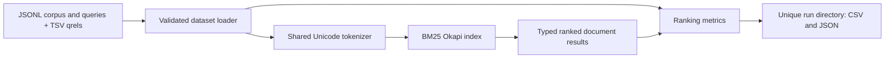
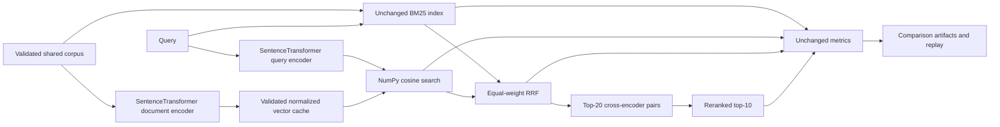
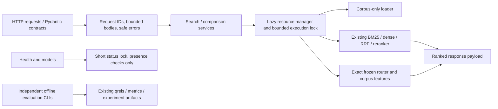

# RankForge architecture

## Phase 7A container boundary

The existing single-worker API runs as non-root PID1 inside a Linux/amd64 CPU image. Docker copies source and pinned dependencies only; corpus, model snapshots, separate Linux dense cache and frozen policy enter through read-only bind mounts. Container-only required-file preflight precedes the unchanged lazy lifecycle. SIGTERM reaches Uvicorn directly. Health calls the existing model-free endpoint; explicit integration verification tests all-method readiness, equivalence, limits and restart. The host verifier writes experiment artifacts. See [Docker guide](docker_deployment.md) for paths, defaults and measured limitations.

## Phase 1 architecture

The benchmark CLI composes independent loading, retrieval, and metric modules. Index construction occurs once per run, outside query timing. The following sections document subsequent extensions.

## Phase 2 extensions

`app.retrieval.base.Retriever` remains the common search contract. Neural dependencies are imported only by model adapters when initialized. The original single-BM25 benchmark CLI remains available; `app.evaluation.comparison` composes all four strategies with independent timed searches. Later phases add frozen routing and the local API below; no dashboard or container is included.

## Phase 5 service boundary

Lifespan owns one manager per process. Local prepared neural adapters and read-only validated vector caches are reused; lazy retriever proxies let the frozen hybrid-only router avoid loading the cross-encoder. No retriever imports FastAPI. API loading uses only corpus.jsonl, and there is no HTTP evaluation/write/download endpoint. A separate status lock keeps health responsive during initialization. Resource setup, complete retrieval and queue waiting are separately measured. The [service guide](api_service.md) describes schemas, concurrency/error boundaries and limitations; prior evaluation architecture remains independent.
